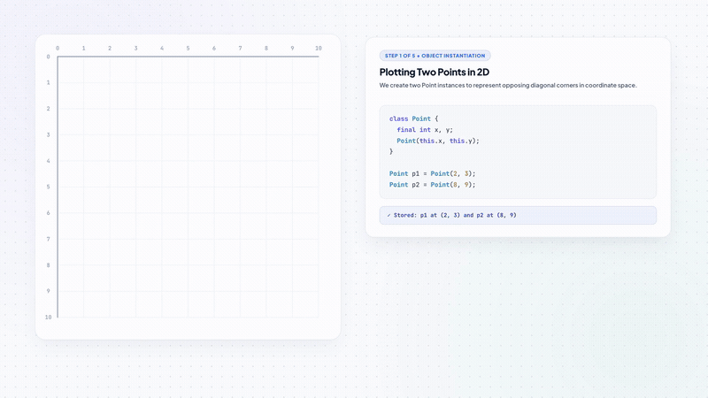

# Motion

A local command-line engine that turns code and algorithms into 1080p educational motion graphics, and generates animated showcase videos from your software projects.

Runs entirely on your machine using free, open-source tools: Python, FFmpeg, and Chrome. No cloud subscriptions, no paid API keys.

<p align="center">
  <a href="docs/assets/dart_rectangle_motion.mp4">
    
  </a>
</p>
<p align="center">
  <b>Sample Output</b>: Dart 2D Geometry &amp; Rectangle Area Calculation (1080p DOM/SVG animation with neural voiceover)<br />
  <a href="docs/assets/dart_rectangle_motion.mp4"><strong>Watch Full 1080p Video with Audio (MP4)</strong></a> &bull; <a href="docs/assets/demo_poster.jpg">View High-Res Keyframe Poster</a>
</p>

---

## What It Does

Most automated video tools output static slides or guess what code is doing. Motion takes a direct, code-first approach:

1. **Traces real execution**: Runs Python code through `sys.settrace` and parses the Abstract Syntax Tree (AST) to record exact line numbers, variables, and runtime state changes.
2. **Synchronizes audio to visual steps**: Generates clear voice narration using Edge-TTS and reads cue timestamps so visual highlights appear exactly when spoken.
3. **Renders web-grade animations**: Uses GSAP timelines and HyperFrames inside headless Chrome with hardware GPU acceleration to render smooth 60fps MP4 video.
4. **Automated visual check**: Samples output frames with FFmpeg and Pillow to detect black frames, overlapping text, or audio drift before finalizing.
5. **Clear, direct language**: Scripts explanations in plain English, avoiding buzzwords and filler.

---

## How It Works

```text
               Input (Code / Algorithm / Project Directory)
                                     │
                                     ▼
        ┌────────────────────────────────────────────────────────┐
        │  1. Code & State Analysis                              │
        │  • Traces runtime variables & active line transitions  │
        │  • Tokenizes and highlights syntax                     │
        └────────────────────────────┬───────────────────────────┘
                                     │
                                     ▼
        ┌────────────────────────────────────────────────────────┐
        │  2. Storyboard & Narration Planning                    │
        │  • Breaks explanation into clear, step-by-step points  │
        │  • Applies visual design tokens (colors, fonts, layout)│
        └────────────────────────────┬───────────────────────────┘
                                     │
                     ┌───────────────┴───────────────┐
                     ▼                               ▼
       [Audio Narration]                   [Motion Layout]
       • Neural voice synthesis            • Two-column layout
       • WebVTT timestamp sync             • GSAP timeline animations
                     │                               │
                     └───────────────┬───────────────┘
                                     │
                                     ▼
        ┌────────────────────────────────────────────────────────┐
        │  3. Frame-by-Frame GPU Rendering                       │
        │  • Headless Chrome renders DOM/SVG at 1080p 60fps      │
        └────────────────────────────┬───────────────────────────┘
                                     │
                                     ▼
        ┌────────────────────────────────────────────────────────┐
        │  4. Assembly & Quality Check                           │
        │  • Muxes video (H.264) and audio (AAC) with FFmpeg     │
        │  • Scans keyframes for blank screens or timing drift   │
        └────────────────────────────────────────────────────────┘
```

---

## Design Presets

Customize the visual appearance with `--style <name>`:

| Style Preset | Look and Feel | Recommended For |
| :--- | :--- | :--- |
| `dark_cinematic` *(Default)* | Dark background, cyan accents, clean monospace typography | Algorithms, systems programming, data structures |
| `technical` | Slate background, blueprint grid, sharp borders | Network protocols, API flows, architecture |
| `mathematical` | Chalkboard aesthetic, gold highlights, serif accents | Math proofs, calculus, linear algebra |
| `anime_cartoon` | Vibrant indigo, pink and neon accents, spring physics | Engaging beginner tutorials, social walkthroughs |

---

## Prerequisites

Before running Motion, ensure these tools are installed:

- **Python** (3.10 or newer): `python3 --version`
- **Node.js** (v20 or newer): `node -v`
- **FFmpeg & ffprobe**: `ffmpeg -version` (e.g. `brew install ffmpeg` on macOS, `sudo apt install ffmpeg` on Ubuntu)

---

## Quickstart

### 1. Clone & Install

```bash
git clone https://github.com/SvayMonirath/motion.git
cd motion

# Install Python dependencies
pip install -r requirements.txt
```

### 2. Generate an Educational Video (`explain`)

Explain an algorithm with step-by-step code execution and voiceover:

```bash
# Default dark cinematic style
python3 bin/motion explain "Explain binary search"

# With a different visual style
python3 bin/motion explain "Explain bubble sort" --style technical

# Render video without voiceover
python3 bin/motion explain "Explain binary search" --no-audio
```

### 3. Generate a Product Showcase Video (`showcase`)

Scan a frontend or mobile codebase and generate a 3D animated showcase:

```bash
# Point to your project folder
python3 bin/motion showcase /path/to/your/project

# Adjust tone (hype, apple-minimal, technical)
python3 bin/motion showcase /path/to/your/project --tone apple-minimal
```

### 4. View Output

Rendered videos, audio tracks, and inspection frames are saved in `output/`:

```bash
# On macOS
open output/binary_search/educational_binary_search.mp4
```

---

## Agent Skill Setup

Motion can also be used as a tool inside AI agent environments (Google Antigravity, Claude Code, Cursor):

```bash
# Link the skill to your Antigravity config
mkdir -p ~/.gemini/config/skills
ln -s "$(pwd)/skills/motion" ~/.gemini/config/skills/motion
```

Once linked, trigger it directly in conversation:
- `/motion-explain Explain how quicksort partitions an array`
- `/motion-showcase Create a launch video for this repo`

---

## Project Structure

```text
motion/
├── bin/
│   ├── motion                  # Main CLI executable
│   └── edumotion.py            # Educational motion runner
├── core/
│   ├── execution_tracer.py     # Python AST and sys.settrace runtime tracer
│   ├── code_highlighter.py     # Pygments syntax highlighter
│   ├── audio_engine.py         # Voiceover synthesis and subtitle timing
│   ├── planner.py              # Storyboard and script planning
│   ├── renderer.py             # HyperFrames and GSAP composition builder
│   └── visual_qa.py            # Frame extraction and quality checks
├── styles/
│   └── presets.py              # Color palettes, typography, and layout rules
├── skills/
│   └── motion/                 # Agent skill definition (SKILL.md)
├── requirements.txt            # Python dependencies
├── .gitignore                  # Git ignore rules
└── README.md                   # Project documentation
```

---

## License

Open source. Free to use, modify, and distribute for personal and educational projects.
